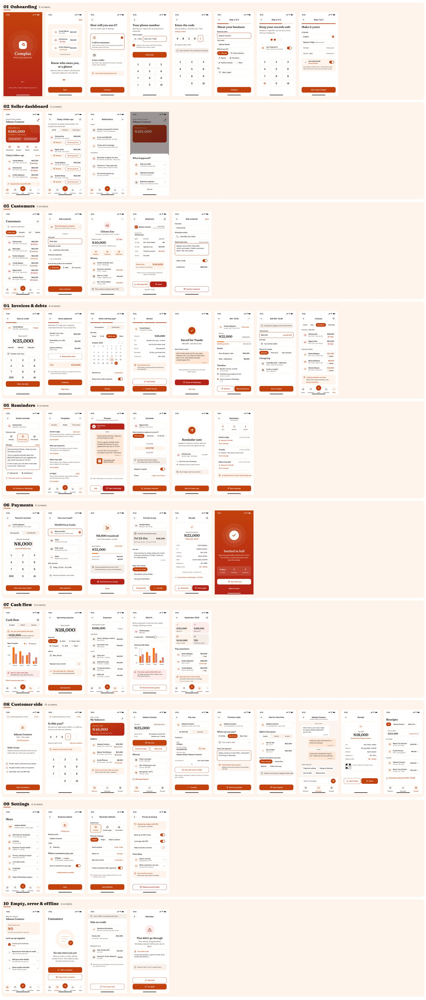
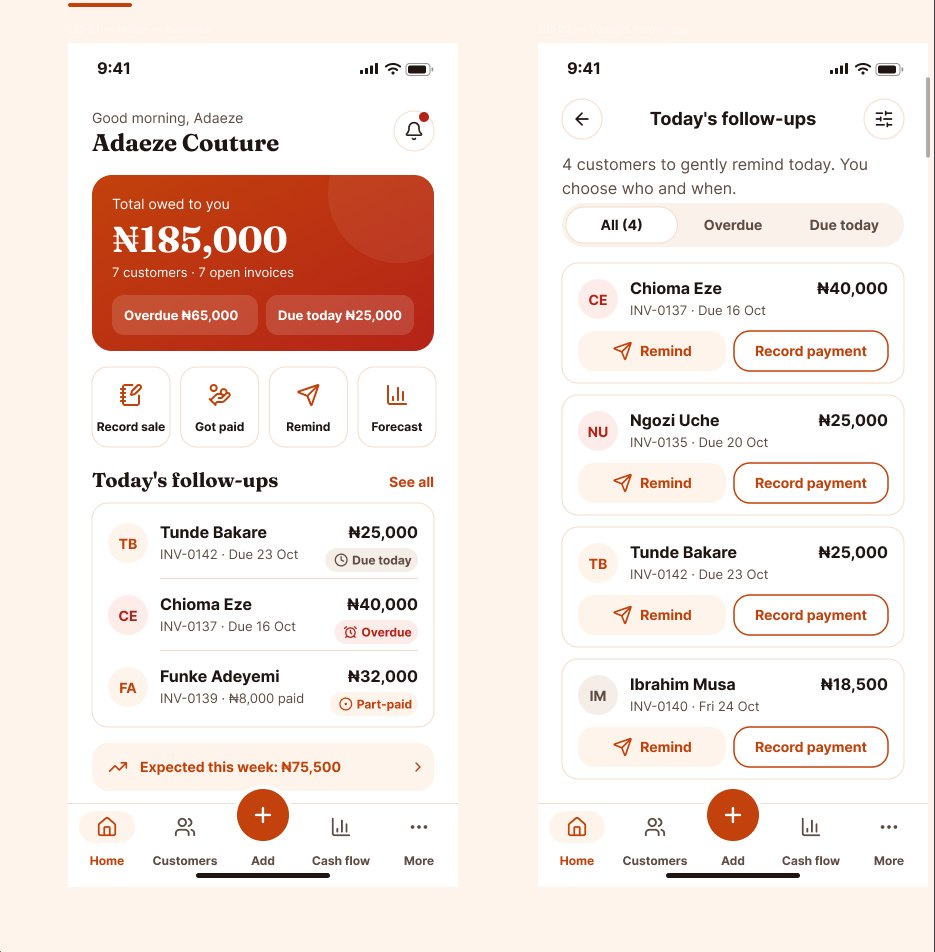
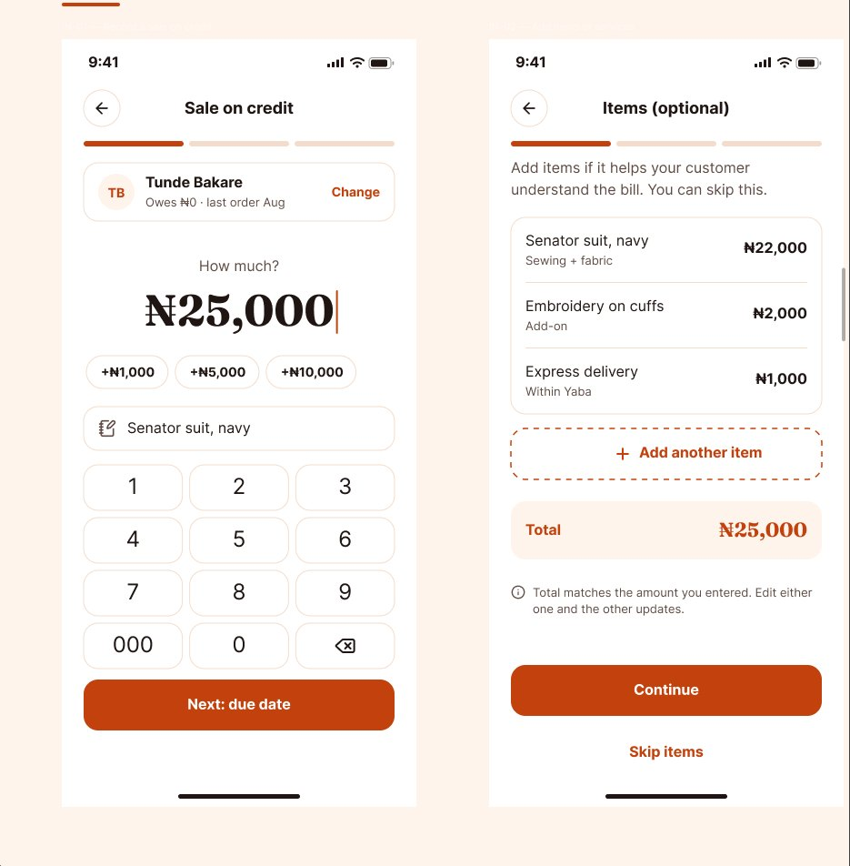
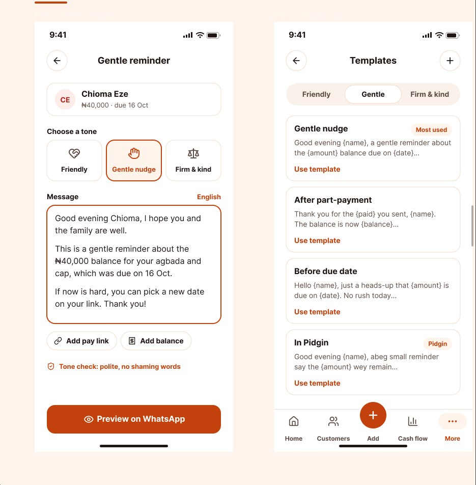
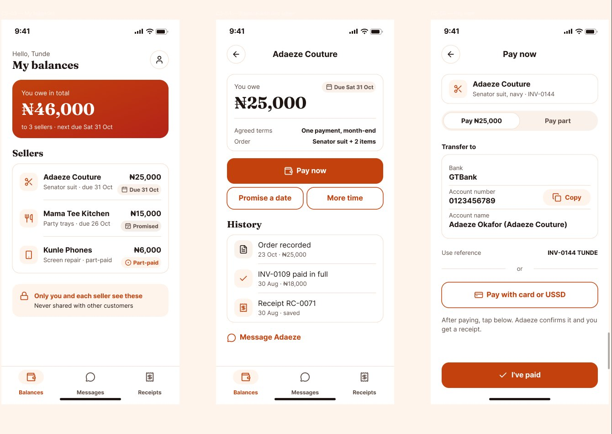

# Complat — UX Case Study

**Helping Nigerian microbusinesses get paid for what they sell on credit, and helping their customers pay with dignity.**

| | |
|---|---|
| **Role** | Clement Olatunde — UX/UI Designer (research, UX strategy, interaction & visual design) |
| **Year** | 2026 |
| **Tools** | Figma, FigJam |
| **Platform** | Mobile-first (Android first), with a light web link for customers |
| **Status** | 60 high-fidelity screens designed in Figma ([view all 60 screens in Figma](https://www.figma.com/design/Ajzn8Jzz3roathlYWGitjs/)). Usability testing is next. |

---

## 1. Overview

Complat is a mobile-first receivables and cash-flow assistant for Nigerian microbusinesses that sell on credit: tailors, food vendors, caterers, repair technicians, and other small traders.

It sits in the gap between **making a sale** and **actually receiving the money**. It does not try to replace banks or payment apps.

Complat has two sides:

- **Seller app:** record who owes what, send polite reminders, track partial payments, and see whether upcoming expenses can be covered.
- **Customer side:** see what you owe, the terms you agreed, pay or promise a date, message the seller respectfully, and keep your receipts.

> The design hypothesis: combining debt tracking, respectful follow-up and cash-flow planning in one simple workflow, with the customer included, is more useful to informal businesses than conventional accounting software.

---

## 2. The problem

*Illustrative scenario.* A tailor in Lagos finishes five customers' orders. Three promise to pay later. She still has to buy fabric, pay for electricity and cover transport, but her money is tied up in unpaid balances.

She doesn't need another payment app. She needs to know, quickly:

- **Who** owes the business money?
- **How much** is outstanding, and **when** was payment promised?
- **Which** customers need a reminder today?
- **Can** the business afford its next expenses while it waits?

The customer has a problem too. Debts are often tracked in the seller's head or notebook, so customers forget amounts, dispute balances, or feel embarrassed by blunt reminders. The relationship suffers, and so does repeat business.

---

## 3. Research

### User research (conducted by Clement Olatunde): conversations with 50+ traders

I spoke with **more than 50 traders** who sell on credit, including tailors, vendors, caterers and repair technicians, to understand how they manage money they are owed. User needs and empathy for both sides of the relationship, the seller and the customer, shaped every decision that follows.

**Key themes**

- **Debts live in notebooks, memory and WhatsApp chats.** Credit is usually agreed informally, and the record is scattered across a notebook, a chat thread and the seller's memory.
- **Chasing payment is awkward.** Sellers find following up uncomfortable and time-consuming, and they worry that pushing too hard will cost them a loyal customer.
- **Partial payments blur the balance.** Once a customer pays part, it gets hard for both sides to know exactly what is still outstanding.
- **Money owed blocks the next expense.** Fabric, electricity and transport still have to be paid while cash is tied up in unpaid balances, so planning ahead is guesswork.
- **Sellers need clear answers, not accounting.** Who owes the business money? How much is outstanding, and when was payment promised? Which customers need a reminder? Can the business afford its next expenses while it waits?

> **Illustrative scenario:** a tailor in Lagos completes five customers' orders; three promise to pay later. She still has to buy fabric, pay for electricity and cover transport, but the money she is owed is tied up in unpaid balances.

### Secondary research

*Published surveys, cited as provided.*

| Source | Finding |
|---|---|
| PwC, 2024 Nigerian MSME survey | Inadequate access to finance was the **leading reported business-growth challenge for 35%** of surveyed businesses. |
| ACCA Nigeria survey (earlier) | **59.9% of surveyed MSMEs** had experienced **delayed payments**. |

**What this adds:** cash flow and late payment are real, widespread pressures for Nigerian small businesses, which matches what traders described in the user research.

**Design context**

- Credit sales are agreed informally and recorded in notebooks, in memory, or in WhatsApp chats.
- WhatsApp is the everyday channel between seller and customer.
- Many users have Android phones, expensive or unreliable data, and mixed literacy levels.
- Payments arrive by bank transfer, cash or POS, often in instalments.

---

## 4. Personas

> **Personas based on research with 50+ traders.** Names and details are representative composites, not individual participants.

### Seller — "Adaeze", tailor, Lagos

| | |
|---|---|
| **Business** | Runs a small tailoring shop with one apprentice. Often lets regular customers pay after collection. |
| **Tools today** | A notebook, her memory, WhatsApp chats, bank alerts on her phone. |
| **Goals** | Know who owes her at a glance. Get paid without losing customers. Buy fabric on time. |
| **Frustrations** | Forgets who paid part. Feels awkward chasing people. Runs short of cash for materials. |
| **Needs from Complat** | Record a debt in seconds, reminders that sound polite, a clear "can I afford this week?" view. |
| **Constraints** | Busy hands, intermittent data, little time for "accounting". |

### Customer — "Tunde", salaried worker, Lagos

| | |
|---|---|
| **Situation** | Buys clothes from Adaeze and food from a caterer on credit; paid at month-end. |
| **Goals** | Remember what he owes and to whom. Pay on time, or say honestly when he can't. |
| **Frustrations** | Unsure of the exact balance after part-payments. Blunt or public reminders feel embarrassing. |
| **Needs from Complat** | One clear balance, the agreed terms, an easy way to pay or promise a date, proof he paid. |
| **Constraints** | Won't install another app just to see one balance. Wants privacy. |

---

## 5. Problem statements & How Might We

**Seller:** Adaeze needs a fast, reliable way to track money owed and follow up politely, because unpaid balances leave her short of cash for materials and bills.

**Customer:** Tunde needs a clear, private view of what he owes and an easy, respectful way to settle or reschedule, because unclear balances and blunt reminders strain the relationship.

**How might we…**

1. …let a seller record a credit sale in under a minute, even offline?
2. …make reminders feel like a courtesy, not a confrontation?
3. …show a seller whether expected payments will cover upcoming expenses?
4. …let a customer see and act on a balance without installing an app?
5. …give both sides one shared, trusted record so balances aren't disputed?

---

## 6. Competitive gap

General categories only. These are the tools sellers rely on today, not a named-competitor teardown.

| What sellers use today | Strengths | Gaps Complat targets |
|---|---|---|
| **Paper notebooks** | Free, fast, no data needed | No reminders, easy to lose, no totals, no forecast, customer can't see it |
| **WhatsApp chats** | Where customers already are | Debts buried in chat, no running balance, reminders written from scratch each time |
| **Bookkeeping / accounting apps** | Records and reports | Built for accounting, not follow-up; complex for informal traders; customer usually left out |
| **Bank & payment apps** | Move money | Show money received, not money owed or promised |

**The gap:** no simple tool joins *record → respectful reminder → partial payment → forecast*, with a customer-facing view, for informal businesses.

---

## 7. User journeys

### Seller journey: sale → record debt → reminder → partial payment → close

| Stage | What she does | Thinking / feeling | Design opportunity (screens) |
|---|---|---|---|
| 1. Sale | Hands over a finished outfit; customer will pay later | "I'll remember… I hope." | Quick-add from the home screen (DB-04) |
| 2. Record debt | Enters customer, amount, due date, terms | "This must be fast, a customer is waiting." | Amount-first entry, contact pick, date chips (IN-01 → IN-05) |
| 3. Remind | Due date arrives | "I don't want to sound rude." | Tone-selected template, WhatsApp preview, she sends it herself (RM-01 → RM-05) |
| 4. Partial payment | Receives ₦10,000 of ₦25,000 by transfer | "How much is left now?" | Record partial payment, new balance shown at once (PY-01 → PY-03) |
| 5. Close | Final payment arrives | Relief | Receipt shared, invoice settled (PY-05, PY-06) |
| Throughout | Plans fabric purchase | "Can I afford this week?" | Cash-flow forecast (CF-01) |

### Customer journey: receive reminder → view balance → pay or promise → receipt

| Stage | What he does | Thinking / feeling | Design opportunity (screens) |
|---|---|---|---|
| 1. Reminder | Gets a polite WhatsApp message with a private link | "Oh, I'd forgotten. Glad it's polite." | Respectful copy, private link (RM-03, CS-01) |
| 2. View balance | Opens the link, verifies with OTP | "How much exactly, and what did we agree?" | Balance, terms, payment history (CS-02 → CS-04) |
| 3a. Pay | Copies account details or uses a pay link | "Easy." | Pay now (CS-05) |
| 3b. Promise | Can't pay today, picks a date or proposes instalments | "At least I can be honest." | Promise a date / ask for more time (CS-06, CS-07) |
| 4. Receipt | Gets confirmation the seller recorded it | "I have proof." | Receipt and history (CS-09, CS-10) |

---

## 8. Information architecture

**Seller app: bottom navigation (5 tabs)**

```
Home ─────── Overview cards · Today's follow-ups · Notifications
Customers ── List · Customer ledger · Statement
  ( + ) ──── Quick add: Sale on credit · Payment received · Expense
Cash flow ── 4-week forecast · Expenses · What-if · Monthly summary
More ─────── Reminders & templates · Invoices · Settings · Help
```

**Customer side: a light link (no install), 3 areas**

```
My balances ── Balance per seller → terms & history
Act ────────── Pay now · Promise a date · Ask for more time · Message seller
Receipts ───── Receipts & payment history
```

Navigation rules: the main jobs are at most two taps from Home; there is one primary action per screen; Back always returns to where you came from.

### Planned screen inventory (60 screens)

| Flow | Screens |
|---|---|
| Onboarding | 8 |
| Seller dashboard | 4 |
| Customers | 5 |
| Invoices / debts | 8 |
| Reminders | 6 |
| Payments | 6 |
| Cash flow | 5 |
| Customer-side app | 10 |
| Settings | 4 |
| Empty, error & offline states | 4 |
| **Total** | **60** |

| # | Flow | ID | Screen |
|---|---|---|---|
| 01 | Onboarding | ON-01 | Splash |
| 02 | Onboarding | ON-02 | Welcome — what Complat does (3-card intro) |
| 03 | Onboarding | ON-03 | Choose your side: I sell / I owe a seller |
| 04 | Onboarding | ON-04 | Phone number sign-up |
| 05 | Onboarding | ON-05 | OTP verification |
| 06 | Onboarding | ON-06 | Business profile (name, trade, city) |
| 07 | Onboarding | ON-07 | Set PIN / fingerprint |
| 08 | Onboarding | ON-08 | Language & low-data mode |
| 09 | Seller dashboard | DB-01 | Home: outstanding, overdue, due today |
| 10 | Seller dashboard | DB-02 | Today's follow-ups queue |
| 11 | Seller dashboard | DB-03 | Notifications (promises, payments, failed sends) |
| 12 | Seller dashboard | DB-04 | Quick-add sheet (sale on credit / payment / expense) |
| 13 | Customers | CU-01 | Customer list (search, sort by amount owed) |
| 14 | Customers | CU-02 | Add customer (manual or from contacts) |
| 15 | Customers | CU-03 | Customer ledger (balance, history, notes) |
| 16 | Customers | CU-04 | Shareable customer statement |
| 17 | Customers | CU-05 | Edit customer & relationship notes |
| 18 | Invoices / debts | IN-01 | Record a sale on credit (amount-first) |
| 19 | Invoices / debts | IN-02 | Add items or services (optional) |
| 20 | Invoices / debts | IN-03 | Due date & terms (one-off or instalments) |
| 21 | Invoices / debts | IN-04 | Review & confirm |
| 22 | Invoices / debts | IN-05 | Debt recorded — share with customer |
| 23 | Invoices / debts | IN-06 | Invoice detail |
| 24 | Invoices / debts | IN-07 | Edit / adjust invoice (with change log) |
| 25 | Invoices / debts | IN-08 | All invoices (filters: due, overdue, part-paid, settled) |
| 26 | Reminders | RM-01 | Reminder composer (tone: friendly / gentle nudge / firm & respectful) |
| 27 | Reminders | RM-02 | Template library |
| 28 | Reminders | RM-03 | WhatsApp preview before sending |
| 29 | Reminders | RM-04 | Schedule a reminder |
| 30 | Reminders | RM-05 | Reminder sent — log entry |
| 31 | Reminders | RM-06 | Reminder history per customer |
| 32 | Payments | PY-01 | Record payment (full or partial) |
| 33 | Payments | PY-02 | Payment method (cash, transfer, POS) |
| 34 | Payments | PY-03 | Partial payment — new balance |
| 35 | Payments | PY-04 | Customer promised a date |
| 36 | Payments | PY-05 | Receipt generated & shared |
| 37 | Payments | PY-06 | Invoice settled — closed |
| 38 | Cash flow | CF-01 | Cash-flow forecast (next 4 weeks) |
| 39 | Cash flow | CF-02 | Add upcoming expense |
| 40 | Cash flow | CF-03 | Expenses list |
| 41 | Cash flow | CF-04 | What-if: a customer pays late |
| 42 | Cash flow | CF-05 | Monthly summary |
| 43 | Customer-side app | CS-01 | Link landing from WhatsApp (no install needed) |
| 44 | Customer-side app | CS-02 | Verify with OTP |
| 45 | Customer-side app | CS-03 | My balances (all sellers) |
| 46 | Customer-side app | CS-04 | Balance with one seller (agreed terms, history) |
| 47 | Customer-side app | CS-05 | Pay now (copy account details / pay link) |
| 48 | Customer-side app | CS-06 | Promise a payment date |
| 49 | Customer-side app | CS-07 | Ask for more time / propose instalments |
| 50 | Customer-side app | CS-08 | Message the seller (respectful presets) |
| 51 | Customer-side app | CS-09 | My receipt |
| 52 | Customer-side app | CS-10 | My payment history |
| 53 | Settings | ST-01 | Settings home |
| 54 | Settings | ST-02 | Business & bank details |
| 55 | Settings | ST-03 | Reminder tone & language defaults |
| 56 | Settings | ST-04 | Privacy, backup & export |
| 57 | Empty, error & offline states | SX-01 | First-use empty dashboard (guided first entry) |
| 58 | Empty, error & offline states | SX-02 | No customers / no debts yet |
| 59 | Empty, error & offline states | SX-03 | Offline — saved on phone, will sync |
| 60 | Empty, error & offline states | SX-04 | Error — reminder or sync failed (retry, keep draft) |

---

## 9. Design principles (empathy first)

1. **Reminders that keep the relationship.** Every reminder template is courteous by default ("Good afternoon Tunde, a gentle reminder…"). The seller reviews and sends it from her own WhatsApp; nothing goes out automatically. There are no shaming words, no red "DEBTOR" labels, and no public lists.
2. **Dignity for customers.** Balances are private behind an OTP link. "Promise a date" and "Ask for more time" are first-class actions, not failures, and the customer's own words are offered as respectful presets.
3. **One shared truth.** Seller and customer see the same balance and the same history. Edits are logged, which reduces disputes.
4. **Low literacy, low data.** Amount-first number pads, icons paired with short labels, date chips (Today, Friday, Month-end), English and Nigerian Pidgin copy with Yoruba, Hausa and Igbo as planned languages. Works offline and syncs later. Light screens, no heavy images.
5. **Accessible by default.** WCAG 2.1 AA contrast (4.5:1 for body text), 48 dp touch targets, minimum 16 px body text, status never shown by colour alone (always icon + label), screen-reader labels.
6. **Naira done right.** Always ₦ with thousands separators (₦185,000), no kobo unless entered, and large, legible balances.
7. **Calm, not alarming.** Overdue is shown as a polite chip (Deep Red text on a soft red tint, with a clock icon), never an alarm, with a clear next step beside it.

---

## 10. Visual direction

**Mood:** warm, energetic and market-friendly, like a busy, well-run shop: orange, red and white, white-dominant so it stays clean and elegant. No green, per the designer's direction. Status colours blend within the same warm family.

### Palette

| Token | Hex | Use | Contrast (measured, WCAG AA 4.5:1) |
|---|---|---|---|
| White (background) | `#FFFFFF` | App and page background | Text sits on it: Ink 17.88:1, Warm Slate 8.19:1, Burnt Orange 5.18:1 — AA |
| Peach Mist | `#FFF4EC` | Cards and surfaces | Burnt Orange on Peach Mist 4.78:1 — AA; Ink 16.52:1 |
| Line | `#F3DCCB` | Dividers and borders only (not text) | decorative |
| Burnt Orange (primary) | `#C2410C` | Primary buttons, active nav, headings, key numbers | 5.18:1 on white, 4.78:1 on Peach Mist — AA; white text on it 5.18:1 |
| Bright Orange | `#F97316` | Charts, progress and highlights only — never text | decorative (not used for text) |
| Deep Red (secondary) | `#B42318` | Secondary accent and emphasis; header gradient `#C2410C` → `#B42318` | white on Deep Red 6.57:1 — AA |
| Soft Red tint | `#FDECEA` | Polite overdue chips (with clock icon), Deep Red text | Deep Red on its tint 5.75:1 — AA |
| Ink | `#1F1512` | Body text, headings | 17.88:1 on white — AAA |
| Warm Slate | `#5E4B43` | Secondary text, captions | 8.19:1 on white — AA |

Paid / settled: a Burnt Orange check icon with "Paid" in Ink on Peach Mist (status is never shown by colour alone). Overdue: Deep Red text on the Soft Red tint with a clock icon and polite copy. Headers and the hero balance card use a gradient from `#C2410C` to `#B42318`, with white text at ≥ 5.18:1 at the lightest point.

### Typography

| Role | Font | Notes |
|---|---|---|
| Headings & big balances | **Fraunces** (soft serif, 600) | Gives the "ledger" elegance; used sparingly for H1/H2 and the hero balance |
| Body & UI | **Inter** (400 / 500 / 600) | Tabular figures for amounts so columns of Naira line up |
| Scale | 32 / 24 / 20 / 16 / 14 | Minimum body text 16 px; 8-pt spacing grid; 4-column mobile grid, 16 px margins |

### Components (planned)

Balance card · status chip (icon + label: Due today, Overdue, Part-paid, Promised, Settled) · customer row · number pad · date chips · tone selector · WhatsApp preview bubble · forecast bar chart · bottom sheet · offline banner.

*Illustrative dashboard data used in mock-ups: total outstanding ₦185,000; overdue ₦65,000; Customer A, Invoice #001, due today, ₦25,000; Customer B, Invoice #002, 7 days overdue, ₦40,000. These are illustrative figures for a proposed design, not live business data.*

---

## Final UI

The 60 high-fidelity screens, built in Figma in the orange, red and white palette.

**[View all 60 screens in Figma →](https://www.figma.com/design/Ajzn8Jzz3roathlYWGitjs/)**



### Close-ups

**Seller dashboard (DB-01) and Today's follow-ups**



**Sale on credit (IN-01) and optional items**



**Gentle reminder (RM-01) and reminder templates**



**Customer side: My balances, a seller's balance (CS-04) and Pay now**



---

## 11. Key design decisions

| Decision | Why |
|---|---|
| Owner reviews and sends every reminder | Keeps the relationship human, and the seller in control of tone and timing |
| Customer side is a link, not a required app | Lowers the barrier: one tap from WhatsApp, OTP for privacy |
| "Promise a date" is a positive action | Turns avoidance into communication; gives the seller forecast data |
| Amount-first recording | The amount is the one thing a busy seller always knows; everything else is optional |
| Offline-first | Data is costly and patchy; nothing should be lost when the network drops |

---

## 12. Usability testing (next step)

The research phase is complete. The next step is testing the Figma prototype with traders and their customers.

**Usability testing (Figma prototype):**

| Task | Measures |
|---|---|
| Record a ₦25,000 credit sale due Friday | Task completion, time on task, errors |
| Send a polite reminder to an overdue customer | Completion, taps, perceived tone |
| Record a ₦10,000 partial payment and state the new balance | Completion, comprehension |
| From the dashboard, say how much is outstanding and overdue | Comprehension accuracy |
| (Customer) Open a reminder link, check the balance, promise a date | Completion, errors, perceived dignity |

---

## 13. Success metrics (targets, not results)

| Metric | Target |
|---|---|
| Record a credit sale | ≥ 90% complete unaided, in under 60 seconds |
| Send a reminder | ≤ 3 taps from the dashboard; ≥ 90% completion |
| Balance comprehension | ≥ 85% correctly state outstanding and overdue amounts |
| Customer pay / promise flow | ≥ 85% complete without help |
| Reminder tone | ≥ 80% of sellers and customers rate it "polite / respectful" |
| Overall usability | SUS score ≥ 75 |
| Post-launch indicators | Share of debts closed on time; average days to payment; weekly active sellers |

---

## 14. Next steps

1. ~~Build the 60 high-fidelity screens in Figma~~ Done: [all 60 screens in Figma](https://www.figma.com/design/Ajzn8Jzz3roathlYWGitjs/), in the orange, red and white palette above.
2. Create the component library and auto-layout system (all screens aligned to the 8-pt grid).
3. Prototype the two core journeys (seller and customer) end to end.
4. Run the usability tests above with traders and their customers; iterate on findings.
5. Update this case study with test results.

---

*Case study by Clement Olatunde, UX/UI Designer, Akure, Nigeria · 2026.*
